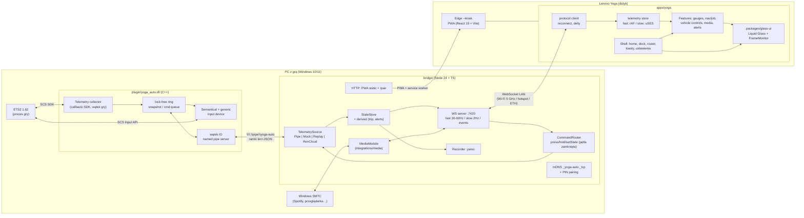
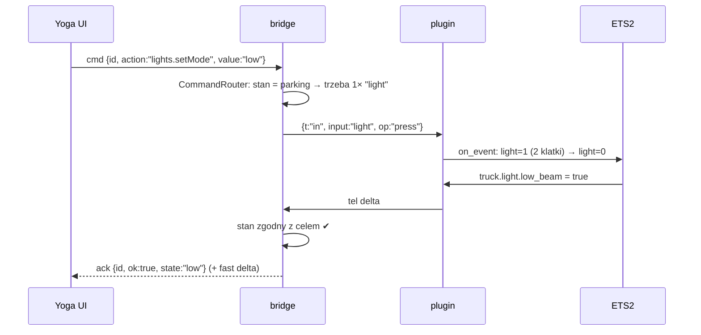

# yoga-auto — architektura

## 1. Diagram



## 2. Struktura repo (monorepo, npm workspaces)

```
/
├─ package.json               # workspaces, skrypty root (lead)
├─ tsconfig.base.json         # (lead)
├─ shared/
│  ├─ protocol/               # KONTRAKT — @yoga-auto/protocol (lead, zamrożony po Fazie 0)
│  └─ design-tokens/          # tokens.json → tokens.css / tokens.ts (lead → S3)
├─ plugin/                    # C++ DLL, CMake (S1)
├─ bridge/                    # Node serwer (S2)
├─ integrations/
│  └─ media/                  # MediaProvider dla bridge'a (S6)
├─ packages/
│  └─ glass-ui/               # design system Liquid Glass (S3)
├─ apps/
│  └─ yoga/                   # PWA
│     ├─ src/shell/           # (S4)
│     ├─ src/core/            # protocol client + store (lead w F0, potem S4)
│     └─ src/features/        # widgety i ekrany (S5), media UI (S6: features/media)
├─ tools/
│  ├─ mock/                   # mock telemetrii (lead F0, potem S7)
│  ├─ recorder/               # nagrywanie/odtwarzanie (S7)
│  ├─ fake-pipe/              # udawany plugin (S7)
│  ├─ bench/                  # benchmark fps (S7)
│  └─ map/                    # generacja PMTiles (S8, M4)
└─ docs/
```

## 3. Komponenty

| Komponent | Odpowiedzialność | Nie robi |
|---|---|---|
| **plugin** | rejestracja kanałów/eventów SDK, snapshot stanu co klatkę, input device (semantical + generic), watchdog hold 3 s, pipe server, log do `%USERPROFILE%\Documents\Euro Truck Simulator 2\yoga-auto.log` | throttlingu, logiki UI, sieci poza localhost |
| **bridge** | źródła telemetrii (pipe/mock/replay), StateStore, derived (trip, alerty, jednostki NIE — jednostki w UI), throttling fast/slow, WS + HTTP + mDNS + parowanie, CommandRouter (press/hold/setState), recorder, hosting modułu media | renderowania, logiki widoków |
| **integrations/media** | implementacja `MediaProvider` (SMTC / helper / media keys) | sieci — wystawia tylko interfejs |
| **glass-ui** | prymitywy Liquid Glass, tokeny w CSS, FrameMonitor + PerfTier, springi | wiedzy o telemetrii |
| **apps/yoga shell** | layout, router ekranów, dock, home grid, sheet, toasty, ustawienia, kiosk (wake lock, blokada gestów), PWA/SW, ekran parowania | konkretnych widgetów |
| **apps/yoga features** | widgety i ekrany: zegary, nawigacja/zlecenie, sterowanie, alerty, komputer | prymitywów szklanych, transportu |

## 4. Przepływ danych

### 4.1 Telemetria (gra → UI)

```mermaid
sequenceDiagram
  participant G as ETS2
  participant P as plugin (wątek gry)
  participant IO as plugin (wątek IO)
  participant B as bridge
  participant Y as Yoga UI
  G->>P: channel callbacks (co klatkę)
  G->>P: frame_end
  P->>P: kopiuje snapshot do ring (seqlock, bez alokacji)
  IO->>IO: budzi się (event), czyta ostatni snapshot
  IO->>B: frame {t:"tel", ...} (max ~60/s, tylko zmienione pola)
  B->>B: StateStore.merge(); derived
  B-->>Y: fast delta co 33 ms
  B-->>Y: slow delta co 500 ms
  G->>P: config/gameplay event
  P->>B: {t:"cfg"|"evt"} od razu
  B-->>Y: config / event od razu
```

### 4.2 Komenda (UI → gra)



Ack przychodzi **po** potwierdzeniu z telemetrii (dla akcji ze stanem) albo po wysłaniu (dla akcji bez stanu, np. klakson). UI pokazuje stan optymistycznie i cofa go po `ok:false` / timeout.

## 5. Decyzje architektoniczne (ADR)

### ADR-001: Własny plugin C++ (telemetria + input w jednym DLL)
- **Kontekst:** RenCloud nieaktualizowany od 2023-09, brak inputu. ETS2LA ma input, ale GPL i własny protokół shared memory.
- **Decyzja:** piszemy `yoga_auto.dll` na oficjalnym SDK 1.16, wzorując się na przykładach z SDK (`examples/input_semantical`).
- **Konsekwencje:** wymagane VS 2022 Build Tools + CMake na PC. Odpowiadamy za stabilność DLL w procesie gry (R2).

### ADR-002: Input przez urządzenie semantical, generic jako plan B
- **Decyzja:** akcje = nazwane kontrolki gry. Brakujące akcje trafiają na urządzenie generic „yoga-auto buttons”, przypisywane raz w grze.
- **Konsekwencje:** niezależność od fokusu i bindów klawiatury. Lista akcji w `shared/protocol/actions.json` ma pole `scs` i `device`.

### ADR-003: Named pipe plugin↔bridge, nie shared memory
- **Kontekst:** Node nie czyta shared memory bez natywnego addonu. Pipe jest dwukierunkowy, ma ACL i sygnalizuje rozłączenie.
- **Decyzja:** `\\.\pipe\yoga-auto`, ramka = `uint32 LE długość` + UTF-8 JSON. Plugin jest serwerem (1 klient), bridge łączy się z retry co 1 s.
- **Konsekwencje:** serializacja JSON w wątku IO pluginu (nie w wątku gry). ~60 ramek/s × ≤ 2 kB to pomijalne obciążenie.

### ADR-004: Bridge w Node 24 + TypeScript
- **Decyzja:** Node (już zainstalowany), współdzielony pakiet `@yoga-auto/protocol`. Dystrybucja: `npm start`, później Node SEA (.exe) + ikona w trayu (M3+).

### ADR-005: WebSocket JSON z kanałami fast/slow/event
- **Decyzja:** jeden WS, typ wiadomości w polu `t`. Delty + keyframe co 10 s. Wersja protokołu w handshake. Szczegóły w [PROTOCOL.md](PROTOCOL.md).

### ADR-006: Frontend jako PWA w Edge kiosk
- **Decyzja:** PWA serwowana przez bridge, cache przez service worker, uruchamiana `msedge --kiosk`. Tauri tylko w razie potrzeby (ten sam bundle).

### ADR-007: React 19 + Vite, szybkie dane poza cyklem renderowania
- **Decyzja:** `useFastValue` → rAF → `element.style` / CSS custom properties. Animacje `motion` (springi). Komponenty szklane w `packages/glass-ui`.

### ADR-008: Liquid Glass z degradacją wydajności
- **Decyzja:** 4 tryby (`ultra/high/lite/flat`), auto-przełączanie na podstawie p95 czasu klatki, ręczny override. Szybkie treści na szkle, nie pod szkłem.

### ADR-009: Bezpieczeństwo LAN
- **Decyzja:** bridge odrzuca połączenia spoza RFC1918/link-local/loopback. WS wymaga tokenu (`Sec-WebSocket-Protocol: yoga-auto.v1, token.<b64>`). Parowanie PIN 6 cyfr, ważny 120 s, max 5 prób. Reguła zapory tylko dla profilu „Private”. Rate limit komend 20/s na klienta. Komendy hold mają twardy limit 10 s.

### ADR-010: Mapa w M4, kafle generowane zewnętrznym narzędziem
- **Decyzja:** truckermudgeon/maps uruchamiane jako narzędzie (nie vendorujemy kodu GPL). Wynik: `europe.pmtiles` serwowany przez bridge, renderowany przez MapLibre.

## 6. Punkty integracji

| # | Punkt | Strony | Kontrakt | Test |
|---|---|---|---|---|
| I1 | pipe plugin ↔ bridge | S1 ↔ S2 | PROTOCOL.md §5 (IPC) | `tools/fake-pipe` (S7) + test z grą |
| I2 | WS bridge ↔ app | S2 ↔ S4/S5 | PROTOCOL.md §2–4, `@yoga-auto/protocol` | testy kontraktu (fixtures), mock |
| I3 | glass-ui API ↔ shell/features | S3 ↔ S4/S5 | DESIGN.md §4 (lista komponentów i propsów) | Ladle stories |
| I4 | shell slots ↔ features | S4 ↔ S5/S6 | `apps/yoga/src/core/registry.ts` (rejestr ekranów/widgetów, F0) | |
| I5 | MediaProvider ↔ bridge | S6 ↔ S2 | `bridge/src/modules/types.ts` (interfejs, F0) | mock provider |
