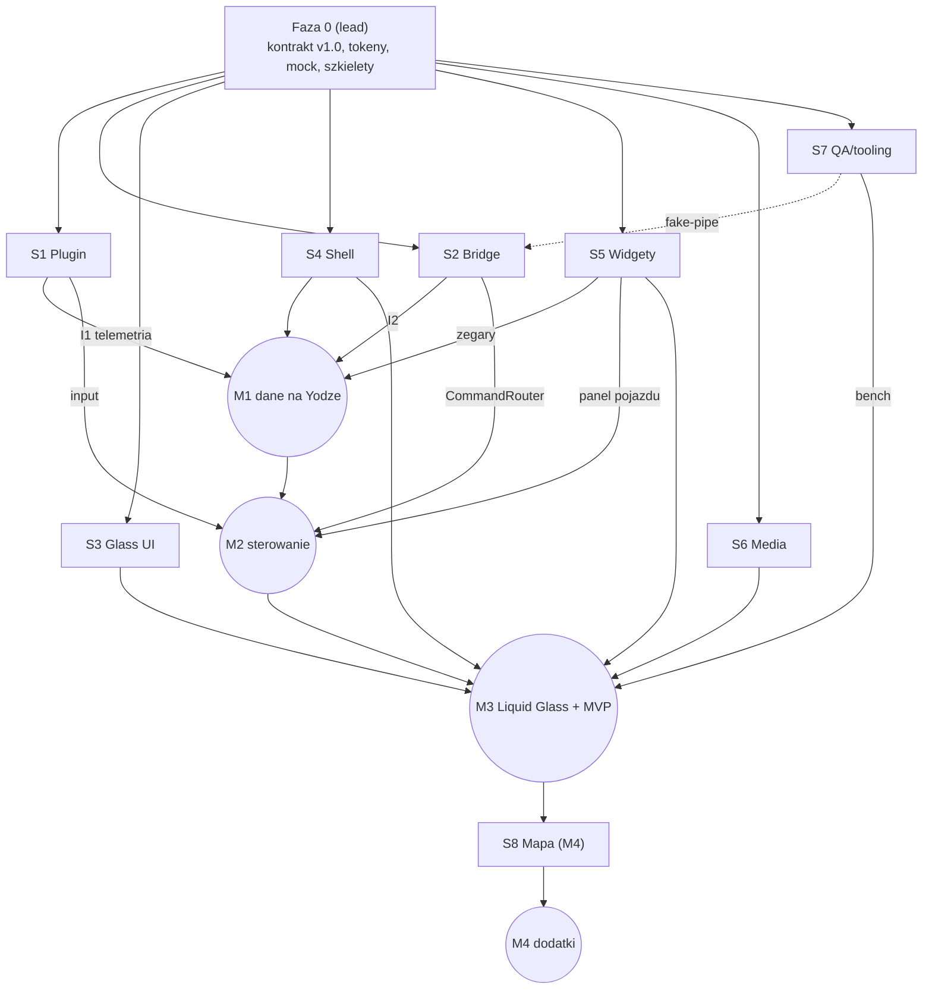

# yoga-auto — plan implementacji (multi-agent)

## 0. Decyzje właściciela (2026-11-22)

| Pytanie | Odpowiedź | Konsekwencja |
|---|---|---|
| Model / Windows Yogi | **Lenovo 83JR = Yoga 7 2-in-1 14AKP10**, AMD Radeon 840M/860M, 14″ **1920×1200** dotyk, **Windows 11 Home** | baza layoutu 1280×800 CSS px (150% skalowania) zgodna z DESIGN.md; domyślny tier `high` + auto; brak Assigned Access → kiosk przez skrót Edge `--kiosk` |
| Multiplayer | **Convoy** (wbudowany MP SCS), nie TruckersMP | ryzyko R6 (TMP) spada; w Convoy gra **nie pauzuje** — `ui.pause` ukryte/wyszarzone, gdy wykryjemy sesję convoy (do sprawdzenia w S1-0, czy SDK to sygnalizuje) |
| Licencja | „może GPL” — **nierozstrzygnięte** | do decyzji pracujemy jak dla MIT: kod GPL (ETS2LA, truckermudgeon) tylko jako referencja, bez kopiowania |
| Łącze | Wi-Fi | zalecane 5 GHz + wyłączone oszczędzanie energii karty na Yodze |
| Muzyka | SMTC (bez konta Spotify) **+ radio w grze** | S6: SMTC; S5: sekcja „Radio w grze” na ekranie media/vehicle z akcjami `radio.*` (semantical, do weryfikacji w S1-0) |
| Plugin | C++ (obojętne) | bez zmian |
| Narzędzia PC | ✅ zainstalowane: **VS Build Tools 2026 (18.7.2)** z MSVC + CMake, Windows SDK 10.0.26100; ✅ SCS SDK 1.16 w `plugin/third_party/scs_sdk_1_16/` | CMake preset na generator „Visual Studio 18 2026” |

## 1. Fazy w skrócie

| Faza | Tryb | Kto | Wynik |
|---|---|---|---|
| **0. Fundament** | sekwencyjnie | lead | monorepo, zamrożony kontrakt, tokeny, mock, szkielety z docelowymi interfejsami |
| **1. Strumienie** | równolegle | S1–S7 | M1 → M2 → M3 |
| **2. Dodatki** | równolegle | S8 + chętne strumienie | M4 |

## 2. Faza 0 (lead, sekwencyjnie). Nic równoległego nie rusza przed jej zakończeniem

| # | Zadanie | Wynik / DoD |
|---|---|---|
| 0.1 | `git init`, `main`, `.gitignore`, `.editorconfig`, `.gitattributes` (LF, poza `*.vcxproj`/`*.sln`) | repo |
| 0.2 | Root `package.json` z **npm workspaces** (`shared/*`, `packages/*`, `apps/*`, `bridge`, `integrations/*`, `tools/*`), `tsconfig.base.json` (strict, `moduleResolution: bundler`, `allowImportingTsExtensions`, `rewriteRelativeImportExtensions`, `verbatimModuleSyntax`, `erasableSyntaxOnly`: importy z rozszerzeniem `.ts`, żeby bridge działał natywnie w Node 24 bez kroku build), ESLint flat + Prettier, Vitest | `npm run check` = typecheck + lint + test, przechodzi |
| 0.3 | `shared/protocol`: typecheck; skrypt `gen`: `generated/actions.json`, `plugin/generated/actions.gen.h`, `plugin/generated/channels.gen.h` (z `PLUGIN_CHANNELS`); JSON Schema (`ts-json-schema-generator`) → `shared/protocol/schema/`; test walidujący **wszystkie fixture'y** względem schematu | kontrakt `v1.0` otagowany `contract-v1.0` |
| 0.4 | `shared/design-tokens`: `tokens.json` wg DESIGN.md §3 → `tokens.css`, `tokens.ts` | import w app działa |
| 0.5 | Szkielet `bridge/`: `TelemetrySource` (interfejs), `CommandSink`, `BridgeModule` (z `broadcast()`, `onClientMsg()`, `registerStatic()`) + `MediaProvider` (`bridge/src/modules/types.ts`), pusty serwer WS, który wysyła `hello`+`snapshot` z mocka | `npm run dev -w bridge` |
| 0.6 | `tools/mock`: `MockSource implements TelemetrySource` ze scenariuszami `highway`, `city-night`, `low-fuel`, `crash`, `job-cycle`; reaguje na komendy (np. `light` zmienia stan) | bridge na mocku wysyła realistyczne dane 30 Hz |
| 0.7 | Szkielet `apps/yoga/` (Vite + React 19 + TS): `src/core/client.ts` (WS + reconnect + seq/resync), `src/core/store.ts` (`useFast`, `useSlow`, `useConfig`), `src/core/registry.ts` (rejestr ekranów i widgetów), `src/core/commands.ts` (`sendCmd` z optymistycznym stanem); placeholder shell | na Yodze/w przeglądarce widać surowy JSON prędkości z mocka |
| 0.8 | Szkielet `packages/glass-ui/`: **finalne sygnatury** komponentów z DESIGN.md §4 jako proste implementacje (div + tokeny, bez efektów) | S4/S5 mogą od razu używać API |
| 0.9 | Szkielet `plugin/`: CMake + VS 2022, ładowanie SDK z `plugin/third_party/scs_sdk_1_16/` (pobiera człowiek), pusty `scs_telemetry_init` logujący wersję gry | DLL ładuje się w grze, log w pliku |
| 0.10 | Szkielet `integrations/media/`: `NullMediaProvider` + `MockMediaProvider` | |
| 0.11 | `docs/OWNERSHIP.md` (tabela z §3) + szablon PR + `docs/proposals/README.md` | |

**Szacunek Fazy 0:** M (1–2 dni pracy agenta-leada).

## 3. Strumienie i własność katalogów

| Strumień | Cel | **Posiada (wyłącznie)** | Czyta (nie edytuje) | Złożoność |
|---|---|---|---|---|
| **S1 Plugin** | DLL: telemetria + input semantical/generic + pipe | `plugin/**` (bez `plugin/generated`) | `shared/protocol` | **L** |
| **S2 Bridge** | serwer: źródła, mapping, throttling, WS/HTTP, mDNS, parowanie, CommandRouter, alerty, trip, recorder hook | `bridge/**` | `shared/protocol`, `tools/mock`, `integrations/media` (interfejs) | **M/L** |
| **S3 Design system** | Liquid Glass: efekty, refrakcja, FrameMonitor, tiery, springi, ikony, Ladle | `packages/glass-ui/**`, `shared/design-tokens/**` (po F0) | DESIGN.md | **L** |
| **S4 Shell** | home, dock, router, status bar, toasty (host), ustawienia, parowanie, kiosk, PWA/SW, wake lock | `apps/yoga/src/shell/**`, `apps/yoga/src/core/**` (po F0), `apps/yoga/{index.html,vite.config.ts,public/**}` | glass-ui API, registry | **M** |
| **S5 Widgety i ekrany** | zegary, jazda, nawigacja/zlecenie, panel pojazdu, alerty (treść), komputer pokładowy | `apps/yoga/src/features/**` **bez** `features/media` i `features/map` | core, glass-ui | **L** |
| **S6 Media** | SMTC → `MediaProvider`, UI odtwarzacza | `integrations/media/**`, `apps/yoga/src/features/media/**` | protocol, glass-ui | **M** |
| **S7 QA i tooling** | recorder/replay, fake-pipe, testy kontraktu, e2e, benchmark fps | `tools/**` (bez `tools/map`), `tests/**`, `e2e/**` | wszystko | **M** |
| **S8 Mapa** (M4) | PMTiles z truckermudgeon/maps, MapLibre, marker | `tools/map/**`, `apps/yoga/src/features/map/**` | protocol, glass-ui | **M** |
| **Lead** | kontrakt, root, integracja, merge | `shared/protocol/**`, root (`package.json`, lockfile, `tsconfig.base.json`, CI), `docs/**` (poza `docs/proposals/`) | — | — |

**Zasady współdzielenia:**
- Nowa zależność npm: agent edytuje `package.json` **swojego** pakietu. Lockfile przy konflikcie regeneruje lead (`npm install`).
- Każdy agent może dodać plik do `docs/proposals/`. Nikt nie edytuje cudzych propozycji.
- Wspólne typy UI (np. `WidgetProps`) są w `apps/yoga/src/core/registry.ts`, którego właścicielem jest S4. Zmiany przez propozycję.

## 4. Zależności



| Strumień | Czeka na | Blokuje | Wejścia (kontrakt) | Wyjścia |
|---|---|---|---|---|
| S1 | F0 | M1 (realne dane), M2 | `ipc.ts`, `actions.ts`, `PLUGIN_CHANNELS` | DLL zgodny z IPC |
| S2 | F0 (+ fake-pipe od S7 przydatny, ale ma własny test double) | M1, M2 | `messages.ts`, `state.ts`, `ipc.ts`, `actions.ts`, `alerts.ts` | WS zgodny z PROTOCOL.md |
| S3 | F0 | M3 (wygląd), nie blokuje M1/M2 (stuby) | DESIGN.md | `@yoga-auto/glass-ui` |
| S4 | F0 | M1 (podstawowy shell) | `messages.ts`, glass-ui API | shell + registry |
| S5 | F0 | M1 (zegary), M2 (panel) | `state.ts`, `actions.ts`, `alerts.ts`, `events.ts` | features |
| S6 | F0 | M3 | `media.ts` | provider + UI |
| S7 | F0 | M3 (bench) | wszystko | narzędzia, testy |

## 5. Git: worktree, branche, merge

```
main                         ← tylko lead merguje; zawsze zielony `npm run check`
├─ contract                  ← zmiany kontraktu (lead), merge do main + tag contract-vX.Y
├─ s1/plugin                 ← worktree ../yoga-auto-s1
├─ s2/bridge                 ← worktree ../yoga-auto-s2
├─ s3/glass-ui
├─ s4/shell
├─ s5/features
├─ s6/media
├─ s7/qa
└─ s8/map (M4)
```

```powershell
git worktree add ..\yoga-auto-s1 -b s1/plugin
```

**Rytm:**
1. Agent pracuje w swoim worktree i robi commity w swoim branchu.
2. Codziennie (albo po zmianie kontraktu) robi `git rebase main`.
3. Gotowy „plaster” (kawałek DoD dla danego M) → PR do `main`. Lead sprawdza `npm run check`, testy integracyjne i właściwy plik `docs/agents/*.md` → merge (squash).
4. **Konflikty:** w katalogach strumienia rozwiązuje właściciel. W plikach root/lockfile rozwiązuje lead. Konflikt semantyczny (np. ktoś potrzebuje zmiany w cudzym katalogu) idzie przez propozycję w `docs/proposals/`, a decyduje lead.

**Kolejność merge'ów:**

| Kamień | Kolejność PR do `main` |
|---|---|
| M1 | S7 (fake-pipe, recorder minimal) → S2 (mapping + fast/slow + pipe source) → S1 (telemetria) → S4 (shell: dock, router, status, parowanie) → S5 (zegary, nawigacja/zlecenie) |
| M2 | S1 (input semantical + watchdog) → S2 (CommandRouter + set-state) → S5 (panel pojazdu) → S7 (testy komend na fake-pipe) |
| M3 | S3 (pełny Liquid Glass + tiery) → S4 (toasty, ustawienia, kiosk, PWA) → S5 (alerty, komputer, polish) → S6 (media) → S7 (bench + e2e) |
| M4 | S8 (mapa) → S5/S4 (edytor układu, tryb nocny auto) |

## 6. Kamienie milowe i kryteria akceptacji

### M1. Dane z gry widać na Yodze
- [ ] ETS2 1.62 z `yoga_auto.dll`: bridge pokazuje `status.connected=true`, wersję gry, listę kanałów.
- [ ] Yoga (Edge) pod `http://<pc>.local:7420`, sparowana PIN-em, pokazuje prędkość, RPM, bieg, paliwo, tempomat, limit, dystans/ETA i zlecenie.
- [ ] Opóźnienie gra → UI: p95 < 50 ms (pomiar: S7, `frame`/`ts` + zegar wspólny przez ping).
- [ ] Reconnect: restart bridge'a / gry / Wi-Fi off-on → UI wraca sam w < 5 s.
- [ ] Bez gry: `npm run dev:mock` daje pełne UI.

### M2. Sterowanie działa
- [ ] Wszystkie akcje `verified:true` z `actions.ts` działają z Yogi, a przyciski świecą zgodnie z telemetrią.
- [ ] Spike S1-0 rozstrzygnął akcje `verified:false`: każda ma `verified:true`, przeszła na `device:"generic"` z instrukcją bindowania albo została usunięta (minor bump kontraktu).
- [ ] `lights.mode` / `retarder.level` (set) osiągają stan w < 500 ms.
- [ ] Klakson (hold) zwalnia się przy zerwaniu Wi-Fi w ≤ 3 s.
- [ ] Gra w fullscreenie, fokus na grze, kierownica podłączona: brak konfliktów.

### M3. Pełny Liquid Glass + MVP funkcji
- [ ] Wszystkie komponenty z DESIGN.md §4 z efektami. Refrakcja w trybach ultra/high.
- [ ] Na Yodze: tier `high` trzyma p95 ≤ 16.7 ms na ekranie Home przy 30 Hz danych. Auto-degradacja działa (test: sztuczne obciążenie).
- [ ] Toasty alertów (wszystkie kody z `alerts.ts`), ustawienia (jednostki, motyw, tier, jasność/noc, fastHz), komputer pokładowy (trip A).
- [ ] Media: tytuł/artysta/okładka + play/pause/next/prev dla Spotify i przeglądarki.
- [ ] Kiosk: autostart, brak zoomu/scrolla/menu kontekstowego, ekran nie gaśnie.
- [ ] Testy kontraktu zielone w TS i C++, e2e na mocku zielone.

### M4. Dodatki
- [ ] Mapa Europy (PMTiles) z pozycją i kierunkiem ciężarówki, follow mode, zoom gestami.
- [ ] Edytor układu home (long-press, drag), trip B, historia zleceń.
- [ ] Tryb nocny automatycznie wg `game.time`.

## 7. Punkty integracji i odpowiedzialność

| Punkt | Test integracyjny | Kto prowadzi | Kiedy |
|---|---|---|---|
| I1 pipe plugin ↔ bridge | fake-pipe ↔ bridge (CI), DLL ↔ bridge (ręcznie z grą) | S2 (bridge jest klientem), S1 dostarcza DLL | przed M1 i M2 |
| I2 WS bridge ↔ app | fixture'y + e2e Playwright na mocku | S7 | ciągle |
| I3 glass-ui ↔ app | Ladle + typecheck | S3 | przed M3 |
| I4 shell ↔ features | registry + e2e nawigacji | S4 | M1 |
| I5 media ↔ bridge | MockMediaProvider → WS → UI | S6 | M3 |

**Sesja integracyjna z grą** (ręczna, Ty + lead) na końcu M1 i M2: checklista z `docs/agents/s7-qa.md` §„Test z grą”.

## 8. Briefy

| Strumień | Brief |
|---|---|
| S1 | [docs/agents/s1-plugin.md](agents/s1-plugin.md) |
| S2 | [docs/agents/s2-bridge.md](agents/s2-bridge.md) |
| S3 | [docs/agents/s3-glass-ui.md](agents/s3-glass-ui.md) |
| S4 | [docs/agents/s4-shell.md](agents/s4-shell.md) |
| S5 | [docs/agents/s5-features.md](agents/s5-features.md) |
| S6 | [docs/agents/s6-media.md](agents/s6-media.md) |
| S7 | [docs/agents/s7-qa.md](agents/s7-qa.md) |
| S8 | [docs/agents/s8-map.md](agents/s8-map.md) |
