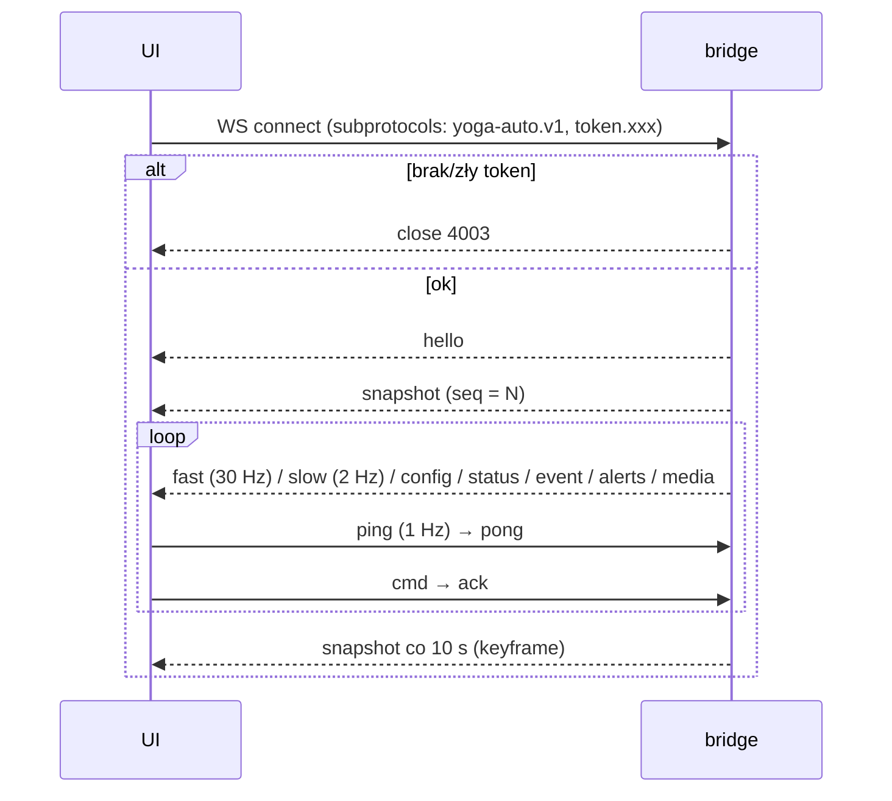
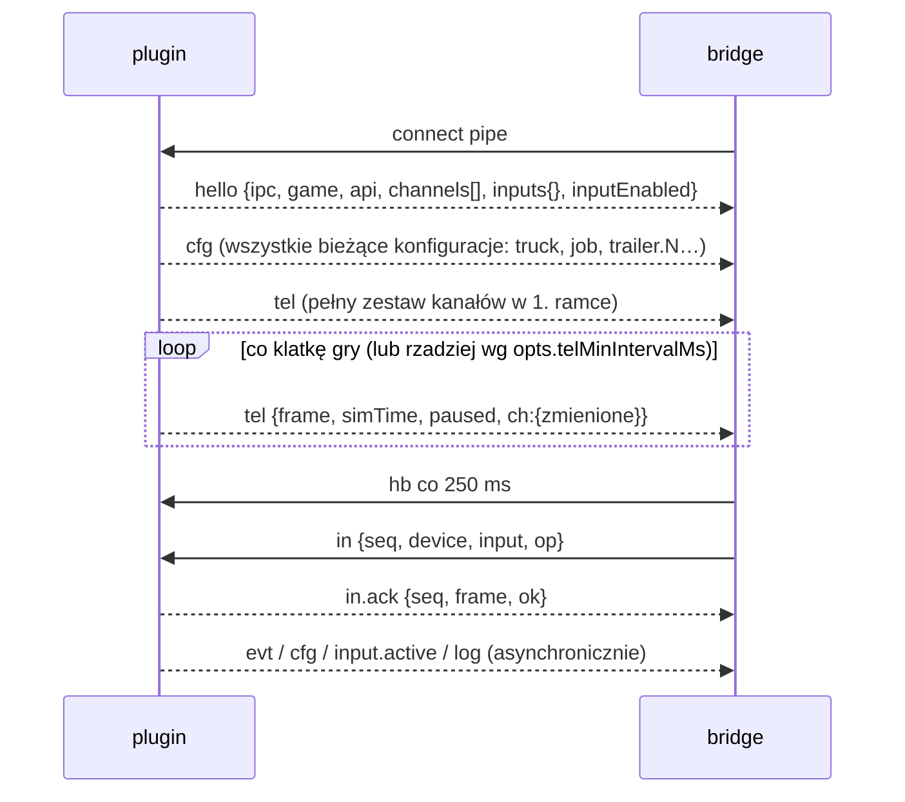

# yoga-auto — protokół (kontrakt między strumieniami)

**Źródło prawdy:** [`shared/protocol/src/`](../shared/protocol/src/) (TypeScript). Ten dokument opisuje semantykę. Typy są w kodzie.
Przykładowe wiadomości do testów kontraktu: [`shared/protocol/fixtures/`](../shared/protocol/fixtures/).

| Plik | Zawartość |
|---|---|
| `version.ts` | wersje, port, nazwy pipe/mDNS, kody zamknięcia WS |
| `state.ts` | `FastState`, `SlowState`, `ConfigState`, `GameStatus`, `FullState` + konwencje jednostek |
| `messages.ts` | wiadomości WS (`ServerMsg`, `ClientMsg`), HTTP parowania, stałe czasowe |
| `actions.ts` | **katalog akcji** (id → kontrolka SCS, typ, stan do podświetlenia) |
| `events.ts` | `GameEvent` |
| `alerts.ts` | `Alert`, `AlertCode` |
| `media.ts` | `MediaState`, `MediaAction` |
| `ipc.ts` | protokół plugin ↔ bridge, `PLUGIN_CHANNELS` |

## 1. Transport

| Warstwa | Bridge ↔ UI | Plugin ↔ bridge |
|---|---|---|
| Kanał | WebSocket `ws://<host>:7420/ws` | named pipe `\\.\pipe\yoga-auto` |
| Kodowanie | ramka tekstowa = 1 obiekt JSON | `uint32 LE długość` + UTF-8 JSON, maks. 256 KiB |
| Autoryzacja | subprotokoły: `yoga-auto.v1`, `token.<base64url>` | ACL pipe: tylko bieżący użytkownik |
| Wersja | `hello.protocol.major` musi = `PROTOCOL_VERSION` | `hello.ipc` musi = `IPC_VERSION` |

## 2. Cykl życia połączenia WS

**Zasady klienta:**
1. Po `hello` porównaj `session`. Jeśli inna niż zapamiętana, wyczyść stan.
2. `fast`/`slow`/`config`/`status` mają rosnący `seq` (wspólny licznik). **Dziura w `seq` → wyślij `resync`.** Do czasu snapshotu stosuj delty dalej (to tylko wizualia).
3. Merge delty jest płytki na poziomie grupy: `fast = { ...fast, ...msg.d }`.
4. Brak jakiejkolwiek wiadomości przez `CLIENT_STALE_MS` (3 s) → zamknij i połącz ponownie (backoff 250 ms → 4 s, jitter ±20%).
5. Nieznany `t`, nieznane pola i nieznane `code`/`kind` → **ignoruj** (zgodność w przód).
6. `pong`: RTT = `now - t0`. UI pokazuje jakość łącza (zielony < 30 ms, żółty < 80, czerwony).

## 3. Kanały danych

| `t` | Częstotliwość | Zawartość | Throttling w bridge |
|---|---|---|---|
| `fast` | `fastHz` (15/30/60, domyślnie 30) | `Delta<FastState>` | tylko zmienione grupy; progi: speed 0.05 m/s, rpm 10, throttle/brake 0.01; `placement` maks. 10 Hz i tylko gdy klient zasubskrybował |
| `slow` | 2 Hz | `Delta<SlowState>` | tylko zmienione grupy; progi: fuel 0.1 l, temperatury 0.5 °C, wear 0.001 |
| `config` | przy zmianie | `Delta<ConfigState>` | brak |
| `status` | przy zmianie | `GameStatus` | brak |
| `event` | natychmiast | `GameEvent` | brak; nigdy nie gubione |
| `alerts` | przy zmianie | `raised[]`, `cleared[]` | brak |
| `media` | przy zmianie + co 5 s, gdy gra muzyka | `MediaState` | UI interpoluje `position` z `positionAt` |
| `snapshot` | po `hello`, na `resync`, co 10 s | `FullState` | — |

**Backpressure:** jeśli `ws.bufferedAmount > 64 KiB`, bridge pomija `fast` (wyśle następny, aktualny stan). `event`, `ack`, `alerts`, `config` nigdy nie są pomijane.

**Gra niepołączona / pauza:** `status.connected=false` → bridge przestaje wysyłać `fast`/`slow`, UI pokazuje stan „Gra nie działa” z ostatnimi wartościami wyszarzonymi. Pauza: `status.paused=true` + `event game.paused`.

## 4. Komendy (UI → gra)

Komenda: `{ t:"cmd", id, action, op?, value? }`. `action` to klucz z `ACTIONS` (`actions.ts`).

| `ACTIONS[a].kind` | Co wysyła UI | Co robi bridge | Kiedy `ack` |
|---|---|---|---|
| `press` | `cmd` bez `op` | `in{op:"press"}` do pluginu | po `in.ack` z pluginu (zwykle ≤ 1 klatka). Jeśli akcja ma `state`, UI dostaje też deltę stanu |
| `hold` | `op:"down"`, potem `op:"keep"` co ≤ 1 s, na końcu `op:"up"` | `in{op:"down"}` / `in{op:"up"}`; sam zwalnia po `HOLD_MAX_MS` (10 s), po rozłączeniu WS, po 3 s bez `keep` | po `down` i po `up` |
| `set` | `value` z `values` | pętla: porównaj stan → wyślij press → czekaj na zmianę stanu (≤ 500 ms) → powtórz (maks. 3 kroki więcej niż teoretycznie potrzeba) | po osiągnięciu stanu (`ok:true,state`) albo `timeout` po `SET_TIMEOUT_MS` |

Szczegóły `set`:
- `lights.mode`: `light` cyklicznie przechodzi off → parking → low → off. Bridge liczy liczbę naciśnięć z aktualnego stanu.
- `wipers.level`: SDK nie raportuje stopnia (`slow.wipers` to bool). Bridge wysyła bezpośrednio `wipersN`, bez weryfikacji, i odsyła `ack ok` po `in.ack`.
- `retarder.level`: różnica `value - fast.retarder` → n × `retarderup`/`retarderdown`.

**Błędy (`ack.error`):** `unknown_action`, `input_disabled`, `game_not_connected`, `game_paused` (komendy poza `ui.pause` odrzucane w pauzie), `invalid_value`, `timeout`, `rate_limited` (> 20/s), `not_supported` (akcja wymaga urządzenia/wejścia, którego plugin nie zarejestrował, patrz `hello.inputs` w IPC).

**UI:** stan optymistyczny po tapnięciu (przycisk zmienia się od razu), cofany przy `ok:false` albo braku `ack` w 2 s. Haptyka/dźwięk kliknięcia natychmiast, niezależnie od ack.

## 5. IPC plugin ↔ bridge

Plugin jest „głupi”: wysyła **surowe nazwy kanałów SDK** i zmienione wartości. Bridge (`bridge/src/mapping.ts`) tłumaczy je na `FastState`/`SlowState`.

**Wymagania twarde dla pluginu:**
- Callbacki SDK (wątek gry) **nie alokują, nie blokują, nie robią IO**. Zapis do bufora dwustronnego/seqlock + `SetEvent`.
- Wątek IO: serializacja JSON, zapis do pipe, odczyt komend → kolejka SPSC → konsumowana w `input_event_callback` przy `first_in_frame`.
- Brak klienta pipe = plugin działa dalej i nic nie buforuje (najnowszy snapshot nadpisuje stary).
- Watchdog: brak `hb` przez 3000 ms → zwolnij wszystkie trzymane wejścia.
- `press` = wartość true przez `PRESS_FRAMES` (3) klatek, potem false. Dwa `press` tego samego wejścia w kolejce wymagają co najmniej 1 klatki z false pomiędzy.
- `scs_telemetry_shutdown` / `scs_input_shutdown` idempotentne (por. RenCloud issue #128).
- Log do pliku + `t:"log"` do bridge'a (poziom ≥ info).

## 6. HTTP

| Metoda | Ścieżka | Auth | Opis |
|---|---|---|---|
| GET | `/` + assety | nie | PWA (statyczne pliki z `apps/yoga/dist`) |
| GET | `/api/info` | opcjonalna | `InfoRes` |
| POST | `/api/pair/start` | nie | bridge generuje PIN 6 cyfr, pokazuje go w konsoli/trayu PC; zwraca `PairStartRes` |
| POST | `/api/pair/confirm` | nie | `PairConfirmReq` → `PairConfirmRes` (token). Maks. 5 prób na `requestId`, PIN ważny 120 s |
| GET | `/media/art/:hash.jpg` | token (query `?k=`) | okładka |
| GET | `/tiles/*.pmtiles` | token | mapa (M4), obsługa `Range` |

Wszystkie endpointy odrzucają adresy źródłowe spoza: `127.0.0.0/8`, `10.0.0.0/8`, `172.16.0.0/12`, `192.168.0.0/16`, `169.254.0.0/16`, `fe80::/10`, `fc00::/7`, `::1`.

## 7. Zarządzanie zmianami kontraktu

1. Kontrakt należy do **leada**. Strumienie **nie edytują** `shared/protocol/`.
2. Potrzeba zmiany → agent pisze plik `docs/proposals/<strumień>-<temat>.md` (co, dlaczego, wpływ) i kontynuuje pracę na lokalnym stubie.
3. Lead scala propozycje do brancha `contract`:
   - addytywne (nowe pole opcjonalne / akcja / event) → `PROTOCOL_MINOR++`;
   - niekompatybilne → `PROTOCOL_VERSION++`, tylko między kamieniami milowymi.
4. Po każdej zmianie: aktualizacja fixture'ów i `CHANGELOG` w tym pliku. Wszystkie strumienie robią rebase na `main`.

## 8. Changelog

| Wersja | Data | Zmiany |
|---|---|---|
| 1.0 | 2026-11-22 | wersja początkowa |
